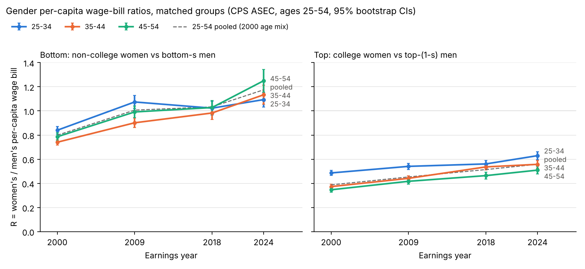

# Gender per-capita wage-bill ratios: hybrid matching design (CPS ASEC)

Did the gender gap in per-capita wage bills narrow more at the bottom than at
the top between 2000 and 2024? This analysis compares women grouped by
education with men grouped by their own earnings rank, so that each women's
group is set against a men's group of the same population share.

- **Women**: `F_bottom` = no BA, `F_top` = BA or higher. `s` = weighted
  non-college share of women in the year x age band.
- **Men** (same year x band): `M_bottom` = bottom `s` share by INCWAGE,
  `M_top` = top `1 - s` share. The boundary block of tied earnings is split
  fractionally (every tied person gets the same fraction), so the shares are
  exactly `s` and `1 - s`.
- `R = PC_f / PC_m`, where PC is the ASECWT-weighted mean INCWAGE with zeros
  included. Decomposition:
  `ln R = ln(E_f/E_m) + ln(H_f/H_m) + ln(w_f/w_m)`. Here E is the employment
  rate (INCWAGE > 0), H is annual hours (WKSWORK1 x UHRSWORKLY) per earner, and
  w is the aggregate hourly wage (total earnings / total hours). H and w are
  computed over earners with positive hours, and with that aggregate definition
  the decomposition is exact. Every earner in these samples reports positive
  hours, so the residual term is 0.

Full tables: [`output/tables.md`](output/tables.md) (CSV versions sit alongside it).
Chart: [`output/ratios_by_band.png`](output/ratios_by_band.png).



## Summary

Measured proportionally, the gap did **not** narrow meaningfully more at the
bottom than at the top. From 2000 to 2024, ln R_bottom rose 26, 43 and 46 log
points in the 25-34, 35-44 and 45-54 bands. ln R_top rose 26, 40 and 39. The
bottom-minus-top differences are 0.6 (SE 4.3), 2.4 (5.1) and 7.9 (5.9), and
2.1 (3.0) for the pooled 25-54 group with the age mix held at 2000 shares.
None is distinguishable from zero. Winsorizing earnings at p99 (R2) flips the
two older bands to slightly faster narrowing at the top. In levels R_bottom
gained more (+0.25 to +0.46 vs +0.14 to +0.18), but only because it started
near 0.8 rather than 0.35-0.49. By 2024, non-college women out-earned their
matched men per capita (R_bottom = 1.09 to 1.25).

Participation explains little on either side (1-6 log points). At the top, and
at the bottom for ages 35-54, most of the narrowing is **hourly wages**: 17-29
of 26-39 points at the top, and 27-32 of 43-46 at the bottom. Hours add about
8-14 points. At the bottom for ages 25-34, **hours** are the largest piece (14
of 26).

The source of the convergence differs by side (real PC, 2024 dollars,
CPI-U-RS). At the bottom it came from **men falling**: M_bottom's real per-capita
wage bill dropped 29-37%, while F_bottom's changed only -7% to +5%. At the top
it came from both: F_top rose 18-24% and M_top fell 9-19%. Part of the "men
falling" is built into the design. As women's college share rose, `s` dropped
from about 0.70 to about 0.53, so the men's cutoff moved down the male
distribution. M_bottom becomes a more negatively selected group (bottom 53%
instead of bottom 70%), and M_top becomes less selective.

The benchmarks show how much the matching choice matters:
- **B1 (education only)** gives the opposite answer. The non-college ratio
  barely moved (-4 to +10 log points), while the college ratio narrowed 17-22
  (bottom - top = -21, -14, -8).
- **B2 (within-sex halves)** shows faster narrowing at the bottom for ages
  25-44 (31 vs 12 and 41 vs 21 log points), driven mostly by hours. At ages
  45-54 the two halves narrowed about equally.

## Headline numbers (main design, 2000 -> 2024, bootstrap SEs)

| band | side | R 2000 | R 2024 | dR | dlnR (log pts) | E | H | hourly |
|---|---|---|---|---|---|---|---|---|
| 25-34 | bottom | 0.840 (0.016) | 1.094 (0.031) | 0.254 (0.035) | 26.4 (3.5) | 4.6 | 14.2 | 7.6 |
| 25-34 | top | 0.486 (0.011) | 0.629 (0.017) | 0.143 (0.020) | 25.8 (3.5) | 1.5 | 7.6 | 16.7 |
| 35-44 | bottom | 0.741 (0.012) | 1.134 (0.040) | 0.393 (0.041) | 42.6 (3.8) | 4.4 | 11.4 | 26.7 |
| 35-44 | top | 0.373 (0.010) | 0.557 (0.016) | 0.184 (0.018) | 40.1 (3.7) | 6.3 | 13.9 | 20.0 |
| 45-54 | bottom | 0.786 (0.017) | 1.250 (0.048) | 0.464 (0.050) | 46.4 (4.3) | 4.1 | 10.7 | 31.5 |
| 45-54 | top | 0.347 (0.010) | 0.510 (0.016) | 0.163 (0.020) | 38.5 (4.7) | 1.4 | 8.3 | 28.8 |
| 25-54 pooled | bottom | 0.799 (0.009) | 1.175 (0.026) | 0.376 (0.026) | 38.6 (2.3) | 4.4 | 12.4 | 21.8 |
| 25-54 pooled | top | 0.387 (0.006) | 0.558 (0.010) | 0.171 (0.011) | 36.5 (2.3) | 3.0 | 9.7 | 23.7 |

E, H and hourly are the log-point contributions; they sum to dlnR.

## Data

The task specifies IPUMS CPS ASEC. The IPUMS account behind this
environment's `IPUMS_API_KEY` is registered for IPUMS USA but **not IPUMS
CPS**: the extract request was refused with "not registered to IPUMS cps". So
this run uses the Census Bureau's public-use ASEC files, the source files IPUMS
harmonizes. `build_extract.py` maps them to IPUMS names and codes:

| IPUMS | Census | notes |
|---|---|---|
| ASECWT | MARSUPWT / 100 | |
| INCWAGE | WSAL_VAL | total wage & salary income; Census codes NIU as 0 |
| EDUC | A_HGA | 43 -> 111 (BA), 44-46 -> 123-125 |
| MARST | A_MARITL | 1,2 -> 1 (spouse present), 3 -> 2 (spouse absent) |
| WKSWORK1 / UHRSWORKLY | WKSWORK / HRSWK | Census NIU is 0 |

For 2001 the script uses the SCHIP-expanded file (`chip2001pub`, 218,269
persons), the same file IPUMS uses for that year. Once the account is
registered for CPS (https://uma.pop.umn.edu/cps/registration/new), the
analysis runs unchanged on IPUMS:

```bash
IPUMS_VARS="YEAR ASECWT AGE SEX EDUC INCWAGE MARST WKSWORK1 UHRSWORKLY" \
  scripts/download_ipums.sh cps2001_03s,cps2010_03s,cps2019_03s,cps2025_03s cps
python3 analysis/gender_wage_ratios/build_extract.py --source ipums
python3 analysis/gender_wage_ratios/analysis.py
```

The deflator is the BLS R-CPI-U-RS annual average
(`https://www.bls.gov/cpi/research-series/r-cpi-u-rs-allitems.xlsx`, saved
under `data/raw/bls_cpi_u_rs/`). The factors to 2024 dollars are 1.832 (2000),
1.470 (2009) and 1.253 (2018).

## Reproduce

```bash
scripts/download_cps_asec.sh                         # ~410 MB into data/raw/census_cps_asec/
mkdir -p data/raw/bls_cpi_u_rs && curl -A "bay-area-extremes/1.0 (research)" \
  -o data/raw/bls_cpi_u_rs/r-cpi-u-rs-allitems.xlsx \
  https://www.bls.gov/cpi/research-series/r-cpi-u-rs-allitems.xlsx
python3 analysis/gender_wage_ratios/build_extract.py # -> cps_asec_harmonized.parquet
python3 analysis/gender_wage_ratios/analysis.py      # 200 reps, ~10 s -> output/
```

Requires `pandas numpy matplotlib pyarrow openpyxl`.

## Implementation notes and caveats

- **Sample**: ages 25-54, ASECWT > 0 (all records), non-earners kept with zero
  earnings. IPUMS NIU codes (INCWAGE 99999998/99999999, UHRSWORKLY 999) are set
  to 0. They don't occur in the Census files.
- **Bootstrap**: 200 reps (seed 20240). Each rep resamples persons with
  replacement within each survey year and keeps ASECWT as the weight. `s`, the
  men's cutoff and every ratio are recomputed in each rep. Resampling persons
  ignores household clustering and the CPS design, so the SEs are probably
  somewhat too small. The ASEC replicate weights would be the design-based
  alternative.
- **Robustness** (Table 5, point estimates):
  - **R1** drops ages 25-29, so the youngest band becomes 30-34.
  - **R2** caps INCWAGE at the weighted 99th percentile of earners within
    year x sex. This matters at the top because top-coding changed, from mean
    replacement in 2001 to rank-proximity swapping from 2011 on.
  - **R3** pools 25-54 and reweights each sex's age-band mix to its 2000
    shares.

  The near-equal proportional narrowing survives all of them. The sign of the
  small bottom-minus-top difference does not.
- **Marriage** (Table 3) is **descriptive only**: men's earnings rank is partly
  endogenous to marriage.
- **Survey changes**: the 2014 income-question redesign and the 2019
  processing-system update raised measured earnings, especially at the top.
  They affect the 2018 and 2024 levels more than the within-year ratios.
