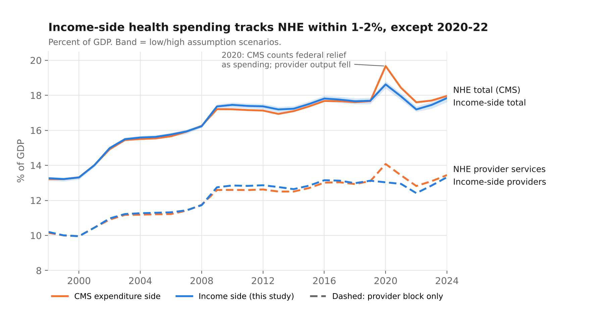

# An income-side estimate of US health care spending, 1998–2024

**Bottom line.** Adding up the income that health spending generates gives **$5,243 billion for 2024**
(assumption range $5,176–5,299 billion) against the CMS National Health Expenditure (NHE) figure of
$5,279 billion: a gap of 0.7%. From 1998 to 2019 the two measures never differ by more than 1.5%.
They split only in 2020–22, when CMS counted federal relief payments as spending while provider
output fell.

## What the numbers say

| | 1998 | 2007 | 2019 | 2020 | 2024 |
|---|---:|---:|---:|---:|---:|
| NHE, CMS ($B) | 1,198 | 2,304 | 3,805 | 4,204 | 5,279 |
| Income-side total ($B) | 1,202 | 2,307 | 3,811 | 3,981 | 5,243 |
| Discrepancy, % of NHE | −0.4 | −0.1 | −0.1 | +5.3 | +0.7 |
| Discrepancy range (low/high scenarios) | −1.0 to +0.7 | −0.7 to +0.8 | −1.1 to +0.9 | +4.4 to +6.5 | −0.4 to +2.0 |
| Domestic labor, % of total | 68.0 | 63.1 | 62.0 | 63.3 | 60.5 |
| Domestic capital income, % | 22.1 | 23.2 | 25.9 | 28.3 | 27.8 |
| Taxes on production less subsidies, % | 3.8 | 4.1 | 3.9 | 0.6 | 3.8 |
| Imports, % | 6.1 | 9.7 | 8.2 | 7.8 | 7.8 |

- **Level.** The match is close but not independent proof that NHE is right. Only the provider block
  (about three quarters of the total) is built from the income side. Retail drugs and equipment,
  insurer net cost, government administration, federal public health, research and investment are
  taken from CMS, so the discrepancy arises entirely among providers. Provider revenue in both
  systems also rests on the same Census surveys.
- **Trend.** Both series grow 5.8–5.9% a year over 2000–2024. The composition shifts: labor's share
  falls from 68% to about 60%, and domestic capital income rises from 22% to 28%.
- **2020–22.** NHE rose 10.5% in 2020; the income-side total rose 4.5%, and income-side provider
  output fell 1.5%. CMS booked $180 billion (2020) and $85 billion (2021) of Provider Relief Fund
  and Paycheck Protection Program money as provider spending. BEA books those as subsidies, so
  provider taxes-less-subsidies swung from +$33 billion to −$55 billion. Excluding that item the
  2020 discrepancy is 1.0%.
- **2008–09.** No comparable divergence: NHE grew 4.2% and 3.8%, the income side 3.9% and 4.8%.

## The stability hypothesis

The hypothesis that the income-side series is more stable is **not supported for the total, and
supported only for labor**.

| Growth-rate volatility (standard deviation, pp) | 2000–2019 | 2000–2024 |
|---|---:|---:|
| NHE total | 2.0 | 2.1 |
| Income-side total | 2.0 | 2.0 |
| NHE provider services | 1.4 | 1.6 |
| Income-side provider output | 1.6 | 2.6 |
| Provider compensation (payroll-based) | 1.4 | 1.4 |
| Domestic capital income (Version B) | 4.2 | 5.0 |
| KFF family premium | 3.5 | 3.4 |

- Before COVID the two totals are equally volatile, partly by construction (shared non-provider
  block).
- Payroll-based compensation is the most stable series. Capital income is the least stable:
  +17% in 2009, −4% in 2022.
- The income side is less distorted by one payer artifact, the 2020–22 relief funding. Rebates,
  Medicaid supplemental payments and provider taxes could not be tested: rebates sit inside the CMS
  retail-drug figure used here, and supplemental payments are not separable in provider revenue.

## Independence

- **Observed directly:** provider payroll (QCEW; BEA compensation is 1.21–1.26 times covered wages
  every year) and hospital surpluses (Medicare cost reports, $82 billion in 2023 for nonprofit and
  non-federal government hospitals).
- **Residual:** BEA's provider gross operating surplus. An independent build from tax-based profit,
  proprietor-income, interest and depreciation data exceeds it by 2.6–7.0% of industry value added
  in every year available.
- **Cross-check:** total revenue on Medicare cost reports is within 3.1% of NHE hospital care in
  every year 1998–2024 (within 1.6% in 2023–24), although cost reports exclude VA and military
  hospitals.
- **Not observable publicly:** private-practice and supplier profit by line of business, the labor
  share of owner-physician income, uniformed military medical pay, and profit booked abroad by drug
  and device makers (it appears here only as imports).

## User-cost variant

Replacing observed capital income of private providers with depreciation plus a 5% real return on
BEA fixed assets leaves a residual of −$11 billion in 1998, +$46 billion in 2019 and +$88 billion in
2024 (1.7% of the total). At 3% and 7% returns the 2024 residual is +$135 billion and +$41 billion.
The residual turns negative in 2022 (−$22 billion at 5%) when hospital surpluses collapsed.

Year-by-year tables are in [tables.md](tables.md); sources and assumptions in
[methods.md](methods.md); open gaps in [gaps.md](gaps.md).
